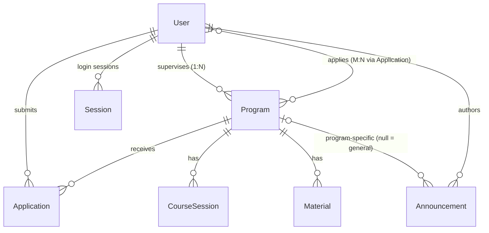

# منصة Youth Sanad — Backend

NestJS + Prisma + PostgreSQL. API كامل لأتمتة رحلة الشاب: تسجيل ← تصفح برامج ← تقديم طلب ← متابعة الحالة ← مواد البرنامج والإعلانات.

## التشغيل

```bash
npm i
npm i @nestjs/bullmq bullmq ioredis @nestjs/throttler @nestjs/cache-manager cache-manager \
      @nestjs/jwt @nestjs/passport passport passport-jwt bcrypt multer \
      class-validator class-transformer @nestjs/mapped-types @nestjs/config \
      @prisma/client @prisma/adapter-pg pg
npm i -D @types/multer @types/bcrypt @types/passport-jwt

cp .env.example .env                 # عدّلي DATABASE_URL والأسرار
docker run -d -p 6379:6379 redis     # Redis لـ BullMQ (اختياري للتشغيل، مطلوب لمعالجة الإشعارات)
npx prisma generate
npx prisma migrate dev --name init   # أو: npx prisma db push
npm run start:dev                    # الـ seed بيشتغل تلقائيًا عند التشغيل
```

> امسحي مجلد `src/generated` القديم (من قالب الـ LMS)، الـ client هلأ بيتولّد من `@prisma/client`.
> أضيفي `uploads/` لـ `.gitignore`.

حسابات الـ seed:

| الدور | الإيميل | كلمة المرور |
|---|---|---|
| ADMIN | admin@sanad.local | Admin@12345 |
| SUPERVISOR | supervisor1@sanad.local / supervisor2@sanad.local | Supervisor@12345 |
| YOUTH | youth1@sanad.local … youth20@sanad.local | Youth@12345 |

بالـ seed كمان: 3 برامج (واحد منهم **Last Seat Demo** فيه مقعد واحد) مع جلسات، وإعلان عام.

## هيكل المشروع

```
src/
├─ main.ts                 # ValidationPipe, CORS, prefix /api, static للصور
├─ app.module.ts           # Config, Throttler, BullMQ, Prisma, Cache, Upload, Auth, Modules, Seed
├─ auth/                   # register / login / refresh / logout / me + JwtStrategy + JwtAuthGuard
├─ modules/                # module لكل جدول بالـ schema
│  ├─ users/  sessions/  programs/  course-sessions/
│  └─ applications/  materials/  announcements/
├─ common/                 # decorators (@Roles, @CurrentUser) · RolesGuard · pagination · cache · upload
├─ queue/notifications/    # BullMQ: queue + processor
├─ prisma/                 # PrismaService (adapter-pg)
└─ seed/
test/                      # last-seat.mjs (سباق آخر مقعد) · smoke.mjs (88 فحص)
```

## مخطط العلاقات (ER)



- **Application** هي جدول الربط M:N بين الشاب والبرنامج، وفيه `@@unique([userId, programId])` (ما بيقدّم مرتين).
- **Session** (الـ auth): بتخزن hash للـ refresh token، وبتسمح بالـ logout وإنهاء جلسة معينة.
- `Program.availableSeats` عدّاد بيتحدّث ذرّيًا داخل transaction.

## كيف تحققت المتطلبات

| المتطلب | التطبيق |
|---|---|
| **Authentication** | JWT: `access_token` (15د) + `refresh_token` (7 أيام). الـ refresh بيدور (rotation) وإعادة استخدامه بتلغي الجلسة كلها. الـ logout بيبطل الـ access token فورًا (الـ strategy بتفحص الجلسة). |
| **Authorization** | `JwtAuthGuard` + `RolesGuard` + `@Roles()` على كل controller. فحص الملكية بالـ service: المشرف بس على برامجه، الشاب بس على طلباته. |
| **Transactions / آخر مقعد** | `UPDATE programs SET availableSeats = availableSeats - 1 WHERE id=? AND availableSeats > 0` داخل `$transaction`. Postgres بيعمل row-lock فالطلبات المتزامنة بتنتظر بالدور؛ الفائزين = عدد المقاعد، والباقي 409 «No seats available». الرفض/الإلغاء بيرجّعوا المقعد (مرة وحدة فقط). |
| **Caching** | قائمة وتفاصيل البرامج + الإعلانات العامة وإعلانات البرنامج. Invalidation بالـ namespace عند أي تعديل (برنامج، جلسة، تقديم/إلغاء/رفض لأنو بيغيّر المقاعد، إعلان) فالشاب بيشوف دايمًا آخر نسخة. |
| **Pagination** | `?page=1&limit=10&search=` على كل القوائم، والرد `{ data, meta: { total, page, limit, totalPages } }`. الحد الأقصى 50. |
| **Throttler** | 100 طلب/دقيقة عام، وحدود أشد على `login` (5) و`register` (10) و`refresh` (20) ضد brute force. |
| **BullMQ** | queue `notifications`: إشعار ترحيب عند التسجيل، وإشعار قرار القبول/الرفض. الـ worker حاليًا بيسجّل بالـ log (مكان إرسال إيميل حقيقي لاحقًا). فشل Redis ما بيكسر الطلب. |
| **Upload** | الملفات على الديسك والـ DB بتخزن المسار بس. أنواع وأحجام مسموحة (صور 5MB، CV 5MB، مواد 20MB)، اسم عشوائي، **فحص magic bytes** للمحتوى، ومسح تلقائي للملف إذا فشل الطلب بعدها. صور البرامج عامة (`/uploads/images/..`)، أما الـ CV والمواد **خاصة** وبتتحمّل عبر الـ API بعد فحص الصلاحيات. |
| **عدم كشف البيانات الحساسة** | `password` ما بيطلع بأي رد (select صريح)، ولا مسارات الملفات الداخلية، ولا إيميلات المشرفين. |
| **الحالات الصعبة** | تقديم مكرر متزامن، إلغاء متزامن، قرار الأدمن مرتين، تقليل المقاعد تحت المحجوز، حذف برنامج (بينمسح ملفاته)... كلها مغطاة بـ `test/smoke.mjs`. |

### حل مشكلة رفع الصورة
أشهر أسباب فشلها وكيف انحلت:
1. الطلب `multipart/form-data` فكل القيم strings (مثل `totalSeats`) ← `@Type(() => Number)` بالـ DTO.
2. الحقل لازم اسمه بالضبط **`image`** (وللـ CV: `cv`، وللمواد: `file`).
3. `ValidationPipe` مع `forbidNonWhitelisted` ← الملف مو جزء من الـ body فما بيتأثر.
4. بـ ESM ما في `__dirname` ← المسارات بتبنى من `process.cwd()`.
5. الصورة ما كانت تنعرض ← `useStaticAssets` بـ `main.ts`.
6. ملفات يتيمة عند فشل الـ validation ← `UploadGuardInterceptor` بيمسحها.

## الـ Endpoints (prefix: `/api`)

**Auth**
| | | |
|---|---|---|
| POST | `/auth/register` | شاب (عام) |
| POST | `/auth/register/supervisor` | ADMIN |
| POST | `/auth/register/admin` | ADMIN |
| POST | `/auth/login` | → `access_token` + `refresh_token` |
| POST | `/auth/refresh` | body: `{ refresh_token }` |
| POST | `/auth/logout` · GET `/auth/me` | مسجّل دخول |

**الشاب (YOUTH)**
| | | |
|---|---|---|
| GET | `/programs` `?page&limit&search` | تصفح + بحث |
| GET | `/programs/:id` | وصف، صورة، المشرف، المقاعد المتبقية، الجلسات |
| POST | `/applications` (multipart: `programId`, `cv`?) | تقديم |
| GET | `/applications/my?status=` | طلباتي |
| PATCH | `/applications/:id/cancel` | إلغاء |
| GET | `/programs/:id/materials` · `/materials/:id/download` | بس إذا مقبول |
| GET | `/announcements/general` · `/announcements/my` · `/programs/:id/announcements` | |
| PATCH | `/users/me` · GET `/sessions` · DELETE `/sessions/:id` | |

**المشرف (SUPERVISOR)** — على برامجه فقط
| | | |
|---|---|---|
| GET | `/programs/mine` | |
| POST / PATCH / DELETE | `/programs` · `/programs/:id` (multipart: `title`, `description`, `totalSeats`, `image`) | |
| POST / GET | `/programs/:id/course-sessions` · PATCH/DELETE `/course-sessions/:id` | المواعيد |
| POST | `/programs/:id/materials` (multipart: `title`, `file`) · DELETE `/materials/:id` | المواد |
| POST | `/announcements` `{ title, content, programId }` · PATCH/DELETE `/announcements/:id` | |
| GET | `/applications` · `/applications/:id/cv` | قراءة فقط لطلبات برامجه |

**الأدمن (ADMIN)**
| | | |
|---|---|---|
| GET | `/users?role=&search=` · `/users/:id` | |
| GET | `/applications?status=&programId=&search=` | كل الطلبات |
| PATCH | `/applications/:id/status` `{ status: "ACCEPTED" \| "REJECTED" }` | قبول/رفض |
| POST | `/announcements` بدون `programId` | إعلان عام |
| * | كل عمليات البرامج/الجلسات/المواد/الإعلانات | على أي برنامج (للأدمن `supervisorId` مطلوب عند إنشاء برنامج) |

## الاختبار

```bash
BASE=http://localhost:3000/api node test/smoke.mjs        # 88 فحص: auth، صلاحيات، رفع، مقاعد، cache...
LOGIN_THROTTLE_LIMIT=1000 npm run start:dev               # (ضروري للاختبار التالي)
BASE=http://localhost:3000/api node test/last-seat.mjs    # 20 شاب على مقعد واحد بنفس اللحظة
```

## قرارات تصميم
- تسجيل المشرف والأدمن مقفول على الأدمن (تسجيل أدمن مفتوح للعموم ثغرة). أول أدمن من الـ seed.
- بعد الإلغاء أو الرفض ما بيقدر الشاب يقدّم مرة تانية على نفس البرنامج (بسبب `@@unique`).
- «الإعلانات الخاصة» بيشوفها الشاب **المقبول** بالبرنامج.
- Cache بالذاكرة (كافي لنسخة وحدة). لعدة instances بتبدليه بـ Redis store.
